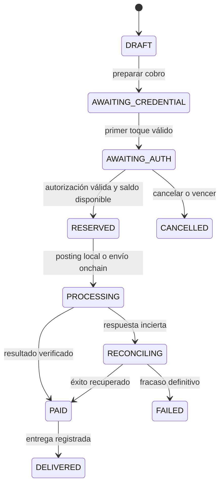

# Compra presencial OGPASS: análisis y diseño propuesto

Fecha: 2026-10-12. Estado: propuesta, no implementada ni habilitada para cobros.
Ejemplo: tienda A vende una camisa blanca al cliente B. El tag identifica una
credencial vinculada a una wallet; no almacena el saldo ni la clave de Stellar.

## Capacidad real del repositorio

| Necesidad | Estado comprobado en código |
|---|---|
| Credencial vinculada a wallet/identidad | Existe: Tag, NormalizedCredential, OgpassIdentity |
| Lectura RC522 y eventos en tiempo real | Existe; aceptación física pendiente |
| Saldo, auditoría, ledger e idempotencia | Existen en core; moneda contable actual CLP |
| Autorización del cliente | Sesión móvil autenticada: core.views.confirm → core.services.decide |
| Segundo toque como aprobación | No implementado; un UID repetido no prueba consentimiento |
| Monto por venta y comercio beneficiario | Falta dominio retail; touch usa amount/cost del Reader |
| Abono a wallet de la tienda | Falta: decide registra ingreso operacional/pasivo de proveedor |
| Smartphone de tienda como lector | Falta app/adaptador NFC y aceptación por plataforma |
| Stellar | StellarAccount guarda dirección; adapters.Stellar solo consulta balances |
| Firma/envío/confirmación Stellar | No existe; vincular dirección no demuestra control de su clave |
| Cifrado de todos los identificadores | No existe: Tag.uid y credenciales normalizadas son legibles en DB |

Los eventos v1 son de consulta; el firmware mantiene PAGAR deshabilitado. No se
modifica esta protección como parte del diseño. Las APIs actuales requieren
confirmación móvil, conforme a la guía del repositorio.

## Límites del medio físico

NTAG213 es NFC pasivo ISO14443A/Type 2, tiene 144 bytes de memoria de usuario y
protección por contraseña de 32 bits. No incorpora Bluetooth ni firma de
transacciones. Su contraseña no proporciona autenticación criptográfica de un
pago. Una referencia firmada estática puede copiarse y reutilizarse; no prueba
presencia fresca ni aprobación de un precio. [Ficha NXP](https://www.nxp.com/docs/en/data-sheet/NTAG213_215_216.pdf).

Para diseño de tag: referencia aleatoria opaca, revocable, sin nombre, saldo,
wallet pública, PRIVATE_ID ni secreto. Una URL NDEF corta podría caber, tras
medir el registro completo. El payload Django firmado actual incluye varios
IDs y caducidad de cinco minutos: no es un formato validado para grabar en NTAG213.
No se escribe ninguna tarjeta en este trabajo.

Bluetooth requeriría un smartphone, wearable o nodo activo adicional. Puede
preparar contexto, pero proximidad/RSSI no identifica al pagador ni aprueba una
compra. El driver BLE actual emite un beacon experimental, no acepta pagos.

Para NFC del comercio, empezar por terminal ESP32 conectada al POS o app Android
con modo lector. La web actual no ofrece por sí sola acceso universal al lector
de cualquier teléfono. iOS requiere integración y pruebas propias de Core NFC;
no se promete compatibilidad automática. [Android NFC](https://developer.android.com/develop/connectivity/nfc),
[Apple Core NFC](https://developer.apple.com/documentation/corenfc).

## Política de autorización recomendada

1. **Versión inicial compatible:** NTAG213 identifica; el cliente ve comercio,
   artículo y total en su móvil autenticado y confirma. Segundo toque opcional
   completa la interacción, pero nunca reemplaza la autorización móvil.
2. **Cliente sin teléfono:** estudiar credencial criptográfica y terminal de
   confianza con pantalla orientada al cliente, límites y PIN cuando corresponda.
   Un NTAG424 DNA aporta AES/autenticación, pero el driver actual no la implementa.
   Un SUN/CMAC válido prueba autenticidad/frescura bajo su protocolo, no que el
   usuario haya visto y aceptado el monto. Se necesita un diseño de autorización
   ligado a la venta y aceptación física. [NXP NTAG424 DNA](https://www.nxp.com/products/NTAG424DNA).
3. **Solo NTAG213 y dos toques:** demostración con fondos ficticios o sistema de
   riesgo explícitamente aceptado, nunca presentado como pago seguro equivalente
   a una firma. Un terminal comprometido puede fabricar el segundo evento; el
   backend no puede demostrar consentimiento a partir de un UID estático.

La segunda opción exige revisar formalmente el contrato de autorización; no
consiste en eliminar el control móvil existente. El cifrado de transporte no
soluciona por sí solo un terminal malicioso o una credencial copiada.

## Flujo UI/UX de caja

Orden preferido: preparar venta antes de pedir el tag. Si el cliente toca primero,
crear una sesión de identificación efímera, nunca una aprobación anticipada.

| Paso | Pantalla del comercio | Pantalla/acción del cliente | Efecto |
|---|---|---|---|
| 1 | Camisa blanca · talla M · cantidad 1 · total 20.000 CLP de ejemplo | Ve el total | Borrador sin débito |
| 2 | Botón Preparar cobro | Acerca su tag | Backend valida comercio/terminal/credencial |
| 3 | Credencial reconocida · esperando confirmación | Retira el tag; revisa tienda y total | Intento ligado a venta y credencial |
| 4 | Total bloqueado · esperando al cliente | Confirma en móvil; segundo toque si se pide | Autorización única y reserva atómica |
| 5 | Procesando · no volver a cobrar | Ve progreso | Posting o envío Stellar según modalidad |
| 6 | Pago confirmado · entregar producto | Recibo privado | Solo tras resultado final exigido |
| 7 | Botón Producto entregado | Recibe camisa/recibo | Entrega registrada por separado |

La caja muestra artículo, total, estado y referencia corta. No muestra saldo
del cliente, UID, dirección Stellar, historial ajeno ni nombre completo por defecto.
Mostrar una máscara efímera como «Credencial ••7F2A», no un identificador global.

El móvil muestra Tienda A, camisa/talla/cantidad, moneda, total con comisiones,
vencimiento, Confirmar y Cancelar. Cualquier cambio de importe, moneda,
beneficiario o carrito invalida la autorización y pide una nueva confirmación.
No se permite al cajero pulsar Confirmar en nombre del cliente.

Texto y símbolo acompañan al color: ámbar «Pendiente», azul «Procesando», verde
«Pago confirmado», rojo «No realizado». Sin animación verde, sonido de éxito ni
instrucción de entrega mientras el estado sea pendiente o incierto.

Ante timeout: «Estamos verificando el pago. No vuelvas a cobrar». Recuperar la
misma venta al reconectar. Sin conexión inicial: no aceptar pagos offline. Rechazo
en caja: motivo mínimo; detalles privados solo al cliente. Tag desconocido no se
asocia automáticamente ni crea una wallet financiada. Otro tag no sustituye al
cliente de una venta en curso; se cancela o reinicia explícitamente.

## Contrato y estados

Estado de compra, autorización, liquidación Stellar y entrega se almacenan por
separado. Una devolución es un nuevo asiento y, si aplica, otra transacción;
nunca borrar ni modificar el asiento original.

Modelo propuesto: Merchant, Membership (cajero/supervisor), Terminal, Sale,
SaleItem, PaymentIntent, Authorization, Reservation, SettlementAttempt,
OutboxEvent y Fulfillment. Reutilizar identidad, wallet, ledger y eventos actuales.
No introducir un segundo ledger ni renombrar sus migraciones.

PaymentIntent fija merchant_id, terminal_id, sale_id, versión del carrito, importe
en unidades menores, moneda/activo, beneficiario, comisión, credencial interna,
nonce, vencimiento y política de autorización. El servidor calcula/revalida el
total y congela una versión; el lector no es autoridad de precios.

Endpoints propuestos, todavía inexistentes:

- POST /api/v1/pos/sales/ y /sales/{id}/payment-intents/ (cajero de ese comercio).
- POST /api/v1/pos/payment-intents/{id}/presentations/ (terminal asignado).
- POST /api/v1/payment-intents/{id}/authorize/ (cliente autenticado y propietario).
- GET /api/v1/pos/sales/{id}/ y canal SSE limitado al comercio/terminal.
- POST /api/v1/pos/sales/{id}/fulfillment/ (cajero, solo tras pago válido).
- POST /api/v1/pos/sales/{id}/refunds/ (permiso supervisor y límites).

event_id identifica una observación; payment_intent_id identifica un cobro.
Idempotency-Key más fingerprint impiden reutilizar clave con otro contenido.
Primer y segundo toque son eventos diferentes vinculados al mismo intento.
Detección de retirada, debounce y nonce evitan repetición accidental, pero no
convierten un NTAG213 en autenticador. Una autorización solo puede consumirse una
vez; bloquear wallet/intento y revalidar saldo/estado dentro de la transacción DB.

## Ledger y Stellar: decidir qué significa registrar

La wallet actual contabiliza CLP. XLM u otro activo Stellar no equivale a CLP;
hacen falta activo/emisor, unidades, financiación, trustlines si corresponden,
reserva mínima, comisiones y conversión/cotización explícitas. Nunca sumar CLP
y XLM en una cuenta ni copiar fondos de testnet a mainnet.

**Diseño inicial recomendado por privacidad:** compra y transferencia interna
cliente→comercio en ledger OGPASS; publicar un compromiso criptográfico por lote
en Stellar. Cada venta recibe su prueba de inclusión, hash de transacción y
ledger de inclusión. Usar hojas con serialización canónica y aleatoriedad privada
suficiente, evitando hashes simples de nombres/importes adivinables. Mantener
fuera de cadena artículos, identidades, UIDs y saldos individuales.

Esto demuestra inclusión de un registro, no movimiento de fondos por cada compra
ni veracidad de la entrega. «Pago OGPASS confirmado» y «Prueba Stellar pendiente/
confirmada» deben ser estados distintos. El anclaje no prueba solvencia.

**Si se exige pago real por venta en Stellar:** construir, firmar, enviar y
verificar una transacción por intento. Con NTAG213 como único objeto del cliente,
la firma tendría que residir en infraestructura custodial o en otro dispositivo:
la etiqueta no firma. Cuenta por usuario expone relaciones; cuenta agrupada con
subledger reduce vinculación directa, pero no vuelve privada la cadena.
[Cuentas agrupadas Stellar](https://developers.stellar.org/docs/build/guides/transactions/pooled-accounts-muxed-accounts-memos).

Ejecución propuesta para pago onchain:

1. Autorizar y reservar saldo en PostgreSQL; crear trabajo outbox en el mismo commit.
2. Worker prepara intento y XDR; firmador aislado valida importe, activo,
   beneficiario, límites y autorización consumible. Claves protegidas en un
   servicio de claves compatible con la firma requerida, nunca en tags/logs/POS.
3. Persistir hash/envelope, red, secuencia y vencimiento antes de enviar.
   Serializar secuencias por cuenta firmante; definir pagador de comisiones.
4. Ante timeout, consultar hash y reenviar el mismo envelope según su validez.
   No generar otra transacción pagadora hasta resolver la anterior.
5. Verificar red, éxito, operación, activo/emisor, importe y destinatario. Solo
   entonces cerrar asientos de liquidación y marcar PAID; si falla definitivamente,
   liberar reserva mediante asiento compensatorio y registrar comisiones reales.
6. Worker de reconciliación recupera caídas entre confirmación de cadena y commit
   local. Durante incertidumbre se mantiene reserva y estado RECONCILING.

No hay transacción atómica compartida entre PostgreSQL y Stellar: outbox,
idempotencia, conciliación y compensaciones son obligatorias. El recibo guarda
el tx_hash y ledger confirmado, no solo la respuesta de envío.
[Envío de pagos Stellar](https://developers.stellar.org/docs/build/guides/transactions/send-and-receive-payments).

Asientos separados para disponible, reservado, pasivo a comercio y comisiones,
balanceados por activo. El modelo actual de ingresos/costo del lector requiere
adaptación contable para retail; no basta cambiar Reader.amount por cada venta.

## Privacidad por actor

| Actor | Información necesaria | Información excluida por defecto |
|---|---|---|
| Cliente | Propias compras, saldos, autorizaciones, recibos y tags | Otros usuarios y secretos del comercio |
| Cajero | Venta actual, total, resultado, referencia y entrega | Saldo/historial global del cliente, UID, claves |
| Dueño del comercio | Sus ventas, devoluciones y liquidaciones | Actividad del cliente en otras tiendas |
| Terminal | Sesión efímera y resultado de su operación | Claves de wallets, exportaciones de usuarios |
| Backend de identidad | Asociación protegida tag→identidad | Acceso libre para cajeros/soporte |
| Worker/firmador | Instrucción validada mínima | Catálogo, nombres y exportación de secretos |
| Soporte/auditor | Acceso por rol, motivo y trazas limitadas | Lectura indiscriminada de datos privados |
| Público en Stellar | Operaciones públicas o compromiso de lote | PII, UID, detalle comercial y secretos |

Proponer TLS verificado; credenciales individuales revocables por terminal;
cifrado autenticado de campos sensibles y backups con rotación de claves;
HMAC separado para búsquedas de identificadores, nunca SHA-256 simple de UID
como promesa de anonimato. Migrar UID raw requiere preservar las búsquedas y
asociaciones actuales; el cifrado de referencias de transporte existente no
significa que todos los datos del proyecto estén cifrados.

Usar alias por comercio/sesión, SSE con permisos por tenant y logs sin secretos.
Separar información personal eliminable del registro contable retenido. Registrar
accesos privilegiados. Identidad opaca estática sigue siendo correlacionable por
lectores físicos; no prometer anonimato absoluto.

Stellar es una cadena pública; TLS/cifrado de la DB no ocultan los pagos allí.
Sus herramientas de pagos privados y tokens confidenciales figuran como developer
preview, no son fundamento de producción para este diseño.
[Privacidad Stellar](https://developers.stellar.org/docs/build/apps/privacy).

## Trazabilidad y aceptación

Cadena de referencias: sale_id → intent_id → credential_ref interna → event_id
→ authorization_id → reservation/journal_id → settlement/tx_hash → fulfillment_id.
Auditar actor, comercio, terminal, versión, fecha servidor, cambios de estado y
motivo. La pantalla del cliente puede ofrecer recibo sin exponer IDs internos.
«Producto entregado» es una declaración registrada, no prueba automática de entrega.

Antes de habilitar dinero real:

- Separación de comercios, cajeros, propietarios y canales SSE.
- Cambio de monto/moneda/beneficiario invalida autorización previa.
- Copia de referencia, doble toque, reenvío, tag distinto y terminal desactivado.
- Dos cajas concurrentes no gastan el mismo saldo ni cobran dos veces.
- Corte de red/reinicio antes y después del envío/confirmación Stellar.
- Reconciliación recupera resultado sin crear otro pago; rechazo libera reserva.
- Devolución parcial/total limitada al monto neto, sin mutar ledger original.
- Compatibilidad física NTAG213/lector/teléfono y UX con cliente sin conocimientos técnicos.
- Revisar custodialidad, activo, comisiones, límites y manejo de terminal comprometido.

Próximo incremento recomendado: POS retail con fondos de prueba, precio variable,
comercio beneficiario, confirmación móvil y trazabilidad completa. Después,
integración Stellar testnet según modalidad elegida. El flujo exclusivo con tag
requiere su propia aceptación de seguridad y hardware.
