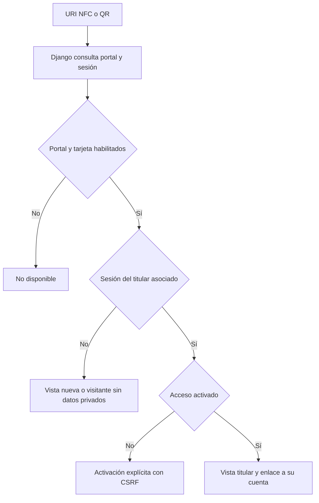

# Portal NFC / QR: integración del patrón WOOD en OGPASS

Implementación: 12/10/2026. No se cuantifica una mejora «10x»: las mejoras
verificables son aislamiento por usuario, acceso móvil, bloqueo y pruebas de
regresión. El análisis de WOOD se basa en la descripción aportada, no en una
auditoría de su código o infraestructura.

## Qué se conserva y qué se adapta

| Patrón de referencia | Integración en OGPASS |
|---|---|
| NFC/QR → URI estable | `/w/<code>/`, código aleatorio de 192 bits, independiente del UID |
| Llavero nuevo / dueño / visitante | Estados renderizados por Django con una misma presentación para HTML y JSON |
| Token por navegador | Sesión Django existente, HttpOnly y SameSite=Lax, Secure en producción, 12 horas |
| Activación | Solo el titular de la tarjeta previamente vinculada por el proceso físico verificado |
| Configuración remota | Título, mensaje público, tema y disponibilidad editables en administración |
| Datos privados | Lista explícita de campos; visitantes no reciben datos privados en HTML ni JSON |
| Autogestión | `/my/tags/`: enlaces, capacidad NTAG213 y bloqueo por pérdida |
| Cuenta/pagos | Acceso a la cuenta existente; no se duplica wallet, ledger ni checkout |
| RPC y RLS | Servicios Django y autorización por propietario; la DB no se expone al navegador |

Un token guardado en un navegador demuestra posesión de ese token, no del
llavero físico. Por ello no se copia el mecanismo `holder_token` de localStorage
ni la recuperación con correo y cuatro dígitos de teléfono. La autenticación
reutiliza la cuenta; una URL no concede propiedad ni autorización financiera.
[OWASP: almacenamiento web](https://cheatsheetseries.owasp.org/cheatsheets/HTML5_Security_Cheat_Sheet.html).

No se introducen TanStack, Supabase ni un MVP paralelo. RLS no se atribuye a esta
implementación: el navegador habla con Django y Django limita sus consultas y
respuestas. El rol PostgreSQL restringido y el ledger existentes se conservan.

## Uso local

Desde `firmware/esp32`, reiniciar el lanzador de desarrollo:

```bash
bash scripts/dev-terminals.sh backend
```

Aplica las migraciones a `mvp/db.nfc-dev.sqlite3`, la DB exclusiva de ese lanzador.
No carga `.env` ni cambia la DB de producción. Ingresar con un usuario de esa DB
y abrir **http://localhost:8000/my/tags/** o «Mis llaveros NFC / QR» en Inicio.

1. Si no hay tarjeta: realizar la asociación existente, con número impreso y
   lectura física fresca validada por personal autorizado en `/ops/`.
2. En Mis llaveros, pulsar **Crear enlace de mi llavero**. Repetir la acción
   conserva el enlace; no crea nuevos tags ni wallets.
3. Abrir el portal e iniciar sesión como titular. Pulsar **Activar mi acceso**.
4. Abrir exactamente el mismo enlace en otro navegador/perfil sin esa sesión:
   solo se muestra la experiencia pública.
5. Probar el bloqueo únicamente con una tarjeta de laboratorio: desactiva `Tag`,
   su credencial normalizada y su portal. No cambia saldo ni ledger.

El enlace usa PUBLIC_URL. `localhost` sirve para pruebas desde ese computador;
un teléfono necesita un origen HTTPS accesible, certificado válido y host
configurado. No grabar una URL local en una tirada de llaveros.

La página calcula el tamaño estimado del registro NDEF URI y su envoltura TLV
contra 144 bytes de memoria NTAG213. Muestra la URL para provisionar NFC o QR;
**no genera una imagen QR, no graba NFC ni demuestra compatibilidad física**.
La grabación y lectura se validan en banco antes de distribución.

## Inventario y configuración remota

Administración: `/admin/core/tagportal/`, con permisos Django de ese modelo.
Solo mostrar textos destinados al público: estos campos no deben contener
nombre del titular, teléfono, deuda ni historial.

- Crear un portal sin tarjeta permite preparar inventario. Su estado será nuevo.
- Tras la asociación física, el administrador asigna una tarjeta existente al
  portal. Un enlace asignado no se puede transferir desde este formulario.
- Alternativamente, el titular genera el portal para su tarjeta desde Mis llaveros.
- Una tarjeta tiene como máximo un portal. Los textos/tema cambian sin alterar
  la URL; no se necesita regrabar el tag.
- Deshabilitar el portal desde administración solo retira el acceso web. El
  botón **Bloquear llavero** del titular bloquea también la tarjeta física en OGPASS.
- La reactivación de una tarjeta bloqueada requiere soporte autorizado, revisando
  tanto el estado de Tag como el portal. No hay autoreclamación pública.

## Estados y acceso



La navegación devuelve al mismo portal después de login/registro. Un usuario
recién registrado no adquiere el llavero por conocer la URL: conserva pendiente
la asociación verificada. No hay efecto financiero al abrir, activar o bloquear.

| Ruta | Método | Acceso |
|---|---|---|
| `/w/<code>/` | GET | Vista pública o titular según sesión |
| `/api/v1/tags/<code>/` | GET | Misma lista permitida de campos |
| `/w/<code>/activate/` | POST | Titular + CSRF; transición idempotente |
| `/w/<code>/block/` | POST | Titular + CSRF + confirmación de bloqueo |
| `/my/tags/` | GET | Solo tarjetas del usuario autenticado |
| `/my/tags/<tag_id>/portal/` | POST | Solo titular + CSRF; provisionamiento idempotente |

`can_activate` solo es verdadero para el titular autenticado. `can_manage` no
autoriza por sí mismo: cada acción verifica nuevamente sesión, wallet y tarjeta.
Staff no se convierte en titular al visitar el portal de otra persona.

## Seguridad y trazabilidad

- El código público no es secreto: copiar el NFC/QR no otorga acceso privado.
  La URL y el estado son metadatos públicos; no se promete «cero exposición».
- Ningún UID, nombre del dueño, saldo, wallet_id o PRIVATE_ID se serializa al
  visitante. Solo el titular activado recibe su propio saludo y fecha de activación.
- El portal se renderiza sin JavaScript ni recursos de terceros. CSP restringe
  recursos y formularios al origen; no-store impide caché HTTP de vistas privadas.
- Referrer-Policy=same-origin evita enviar el enlace a otros sitios y conserva
  las comprobaciones Origin/Referer de CSRF. No se aceptó `Origin: null` para
  solucionar el fallo detectado en la primera prueba de navegador.
- Rate limiting por IP compartido en DB: 120 GET/min y 10 POST/min para el
  conjunto de rutas del portal. Cambiar el código no reinicia el contador.
  NATs de gran volumen requieren ajustar límites y protección del proxy.
- Generación, configuración, activación y bloqueo se auditan usando ID interno,
  sin guardar cookies. Las visitas públicas no generan eventos financieros.
- Activación/bloqueo bloquean wallet y registros asociados en transacción.
  Eventos de wallet se emiten en esa transacción; PostgreSQL notifica al commit.
- Sesiones HttpOnly reducen exposición del identificador a scripts, pero no
  eliminan todos los efectos de XSS o de un dispositivo ya comprometido.
- No se añade cifrado de todos los UID en esta fase. El cifrado de referencias
  externas del MVP no debe confundirse con cifrado universal de la DB.

## Archivos y migración

Dominio: `backend/apps/tag_portal/{models,services,views,urls,admin}.py`.
UI: `frontend/templates/tag_portal/` y `frontend/static/css/tag-portal.css`.
El modelo conserva app_label `core`, con migración aditiva `0011_tag_portal`.
No cambia balances ni modifica registros existentes; se crean portales solo
mediante acciones explícitas. `core/models.py` y `core/admin.py` lo registran.
Se integran rutas, cabeceras y límites; login/registro conservan retorno seguro.

## Verificación

Desde `mvp/`, con configuración exclusiva de pruebas:

```bash
env -u POSTGRES_HOST DEBUG=1 OGPASS_ENV=test .venv/bin/python manage.py test core --verbosity 2
# Con POSTGRES_HOST y demás variables de una DB exclusiva de pruebas:
DEBUG=1 OGPASS_ENV=test .venv/bin/python manage.py test core core.browser_tests backend.tests.browser_tag_portal --verbosity 2
```

La suite incorpora pruebas de privacidad entre usuarios y staff, CSRF,
idempotencia, bloqueo de cobro pendiente, URLs sin permisos, textos escapados,
login/registro, capacidad NDEF y concurrencia PostgreSQL. El navegador usa dos
contextos aislados y anchos 375/390/430/768/1440. Evidencia y resultados en
`evidence/tag-portal-20261012/`; son usuarios de prueba, sin pagos ni lecturas RF.

## Pasos siguientes para integrar el resto del producto

1. Aceptación física de URL NDEF y QR en dispositivos objetivo, con dominio HTTPS.
2. Recuperación de cuenta por canal verificado o passkeys, con revocación de
   sesiones. No usar correo + últimos cuatro dígitos como prueba suficiente.
3. POS/comercios con permisos por organización, carrito, monto congelado y
   consentimiento móvil. Diseño previo: `RETAIL_NFC_UX_DESIGN.md`.
4. Elegir anclaje de prueba o liquidación real Stellar; implementar primero en
   testnet la firma, outbox, reservas y reconciliación necesarias.
5. Validar credenciales criptográficas si se requiere pago sin teléfono.

La captación de leads, referidos, WhatsApp y Shopify de WOOD no se incorporan a
las finanzas de OGPASS: requieren reglas, consentimiento e integraciones propias.
Este incremento deja operativo el portal multiusuario y conserva los controles
actuales de asociación, pagos y contabilidad.
